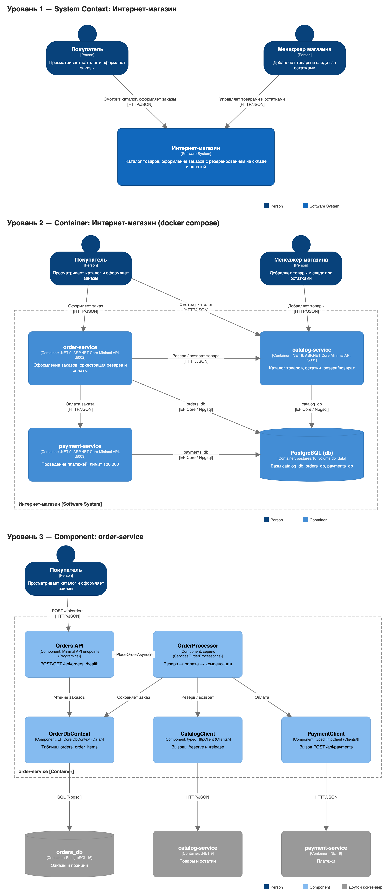

# Интернет-магазин на микросервисах (.NET 9 + PostgreSQL + Docker Compose)

Учебный проект: backend интернет-магазина, разделённый на 3 сервиса. Каждый сервис отвечает за свою часть, у каждого свой API, свой Dockerfile и своя база в PostgreSQL. Всё запускается одной командой `docker compose up`.

## Какую задачу решает система

Покупатель выбирает товары и оформляет заказ. Система должна:

1. проверить, что товар есть на складе, и **зарезервировать** его;
2. **провести оплату**;
3. если оплата не прошла, **вернуть товар на склад**, чтобы остатки не «зависли».

### Минимальный сценарий

| # | Действие | Что происходит |
|---|----------|----------------|
| 1 | `GET /api/products` | Покупатель смотрит каталог (catalog-service) |
| 2 | `POST /api/orders` | order-service резервирует товары в catalog-service, затем вызывает payment-service. Заказ получает статус **Paid** |
| 3 | `GET /api/products/{id}` | Остаток товара уменьшился |
| 4 | `POST /api/orders` на сумму больше 100 000 | payment-service отклоняет платёж, order-service возвращает товар на склад. Статус **PaymentFailed** |
| 5 | `POST /api/orders` на количество больше остатка | catalog-service отказывает в резерве. Статус **Rejected**, HTTP 422 |
| 6 | `docker compose down` → `up` | Заказы, платежи и остатки на месте, потому что лежат в volume `db_data` |

## Сервисы

| Сервис | Порт на хосте | Ответственность | База |
|--------|---------------|-----------------|------|
| **catalog-service** | 5001 | Каталог товаров, остатки, атомарный резерв и возврат товара | `catalog_db` |
| **order-service** | 5002 | Оформление заказов. Оркестрирует резерв → оплату → компенсацию | `orders_db` |
| **payment-service** | 5003 | Проведение платежей. Имитирует банк: сумма больше лимита (100 000) отклоняется | `payments_db` |
| **db** | 5434 → 5432 | PostgreSQL 16, данные лежат в volume `db_data` | — |

### API

**catalog-service** — `http://localhost:5001`

| Метод | Путь | Описание |
|-------|------|----------|
| GET | `/health` | Проверка работоспособности |
| GET | `/api/products` | Список товаров |
| GET | `/api/products/{id}` | Товар по id |
| POST | `/api/products` | Добавить товар `{"name","price","stock"}` |
| POST | `/api/products/{id}/reserve` | Зарезервировать `{"quantity"}` → 409, если товара не хватает |
| POST | `/api/products/{id}/release` | Вернуть на склад `{"quantity"}` |

**order-service** — `http://localhost:5002`

| Метод | Путь | Описание |
|-------|------|----------|
| GET | `/health` | Проверка работоспособности |
| POST | `/api/orders` | Оформить заказ `{"customerName","items":[{"productId","quantity"}]}` |
| GET | `/api/orders` | Все заказы с позициями |
| GET | `/api/orders/{id}` | Заказ по id |

**payment-service** — `http://localhost:5003`

| Метод | Путь | Описание |
|-------|------|----------|
| GET | `/health` | Проверка работоспособности |
| POST | `/api/payments` | Провести платёж `{"orderId","amount"}` → `Approved` / `Declined` |
| GET | `/api/payments?orderId=` | Платежи (можно отфильтровать по заказу) |
| GET | `/api/payments/{id}` | Платёж по id |

## Взаимодействие сервисов

Сервисы общаются синхронно по **HTTP/JSON** внутри docker-сети `shop-net` и обращаются друг к другу по именам сервисов из compose:

```
Клиент ──POST /api/orders──▶ order-service
                               │ 1. POST http://catalog-service:8080/api/products/{id}/reserve
                               │ 2. POST http://payment-service:8080/api/payments
                               │ 3. (при отказе) POST http://catalog-service:8080/api/products/{id}/release
                               ▼
                           orders_db (сохраняет заказ и статус)
```

Адреса зависимостей передаются в order-service через переменные окружения `Services__CatalogUrl` и `Services__PaymentUrl`. Резерв атомарный: `UPDATE products SET stock = stock - q WHERE id = ? AND stock >= q`, поэтому два параллельных заказа не уведут остаток в минус.

## База данных

- Отдельный сервис `db` на образе `postgres:16`.
- Данные хранятся в именованном volume **`db_data`** (`/var/lib/postgresql/data`), поэтому переживают `docker compose down` и пересоздание контейнеров.
- `db/init.sql` при первом запуске создаёт три базы: `catalog_db`, `orders_db`, `payments_db` (принцип database-per-service).
- Таблицы каждый сервис создаёт сам при старте (EF Core `EnsureCreated`). catalog-service также добавляет 4 стартовых товара. Если БД ещё не готова, сервис повторяет попытку подключения.
- Сервисы стартуют только после того, как `db` пройдёт healthcheck (`pg_isready`), за это отвечает `depends_on: condition: service_healthy`.

## Docker

**Dockerfile** (одинаковая схема у всех трёх сервисов): multi-stage сборка.
1. `mcr.microsoft.com/dotnet/sdk:9.0`: сначала копируется только `.csproj` и выполняется `dotnet restore` (этот слой кешируется), затем `dotnet publish -c Release`.
2. `mcr.microsoft.com/dotnet/aspnet:9.0`: в лёгкий runtime-образ копируется только опубликованное приложение. Приложение слушает порт 8080.

**docker-compose.yml** описывает 4 сервиса (`db`, `catalog-service`, `order-service`, `payment-service`), сеть `shop-net`, volume `db_data`, переменные окружения (строки подключения, адреса сервисов, лимит оплаты), проброс портов и порядок запуска.

## Запуск

Нужен Docker Desktop или Docker Engine с Compose v2.

```bash
git clone <url-репозитория>
cd <папка-репозитория>
docker compose up -d --build     # первый запуск: сборка образов ~1-2 мин
docker compose ps                # должно быть 4 контейнера, db — (healthy)
```

Проверить сценарий:

```bash
bash docs/requests.sh
```

Или импортировать в Postman коллекцию `postman/shop.postman_collection.json`.

Проверить сохранение данных:

```bash
docker compose down              # без -v: volume db_data сохраняется
docker compose up -d
curl http://localhost:5002/api/orders     # заказы на месте
docker compose exec db psql -U shop -d orders_db -c "SELECT * FROM orders;"
```

Остановить и полностью удалить данные: `docker compose down -v`.

> Если порты 5001–5003 или 5434 на машине заняты, поменяйте левую часть в `ports:` в `docker-compose.yml`.

### Примеры curl

```bash
# каталог
curl http://localhost:5001/api/products

# оформить заказ (успешная оплата)
curl -X POST http://localhost:5002/api/orders -H "Content-Type: application/json" \
  -d '{"customerName":"Иван Петров","items":[{"productId":2,"quantity":1},{"productId":3,"quantity":2}]}'

# заказ дороже 100 000 → PaymentFailed, товар возвращается на склад
curl -X POST http://localhost:5002/api/orders -H "Content-Type: application/json" \
  -d '{"customerName":"Анна Смирнова","items":[{"productId":1,"quantity":2}]}'

# платежи по заказу
curl "http://localhost:5003/api/payments?orderId=1"
```

## Архитектура (C4)

- `docs/architecture.drawio` — редактируемая схема (открывается в diagrams.net), 3 страницы:
  1. **System Context**: покупатель и менеджер работают с системой «Интернет-магазин».
  2. **Container**: 3 сервиса и PostgreSQL внутри системы, связи HTTP/JSON и EF Core.
  3. **Component**: внутреннее устройство order-service (Orders API → OrderProcessor → CatalogClient / PaymentClient / OrderDbContext).
- `docs/architecture.png` и `docs/architecture.pdf` — экспорт схемы.
- `docs/gen_architecture.py` — генератор схемы (drawio и PNG/PDF собираются из одной модели).



## Подтверждение работы

Реальный вывод команд лежит в `docs/evidence/`:

| Файл | Что показывает |
|------|----------------|
| `01-compose-up.txt` | `docker compose up -d --build` с нуля |
| `02-compose-ps.txt` | `docker compose ps`: 3 сервиса и db (healthy) |
| `03-api-scenario.txt` | весь сценарий через curl (`docs/requests.sh`) |
| `04-service-logs.txt` | логи order-service: Paid / PaymentFailed / Rejected |
| `05-persistence.txt` | down → up: данные сохранились, SQL-запросы к базам |

## Технологии

- C# / .NET 9, ASP.NET Core Minimal API
- Entity Framework Core 9 + Npgsql
- PostgreSQL 16
- Docker (multi-stage Dockerfile), Docker Compose
- curl, Postman
- diagrams.net (draw.io) для C4

## Структура репозитория

```
├── docker-compose.yml
├── db/init.sql                       # создание баз сервисов
├── services/
│   ├── catalog-service/              # Program.cs, Data/, Dockerfile
│   ├── order-service/                # Program.cs, Services/, Clients/, Data/, Dockerfile
│   └── payment-service/              # Program.cs, Data/, Dockerfile
├── docs/
│   ├── architecture.drawio / .png / .pdf
│   ├── requests.sh                   # curl-сценарий
│   └── evidence/                     # вывод команд для защиты
└── postman/shop.postman_collection.json
```
